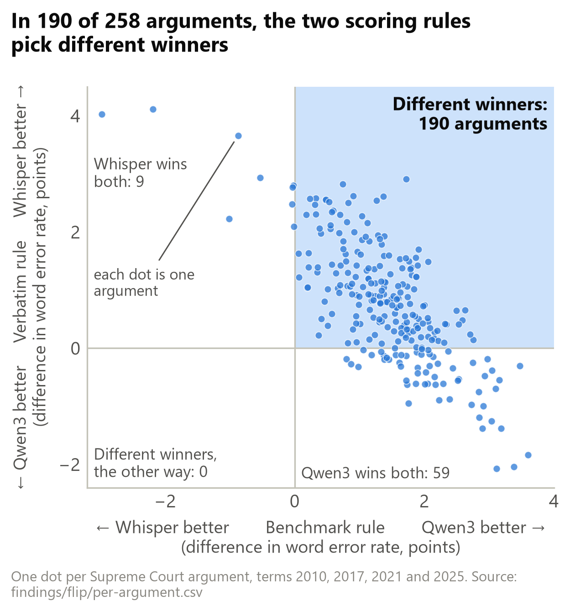
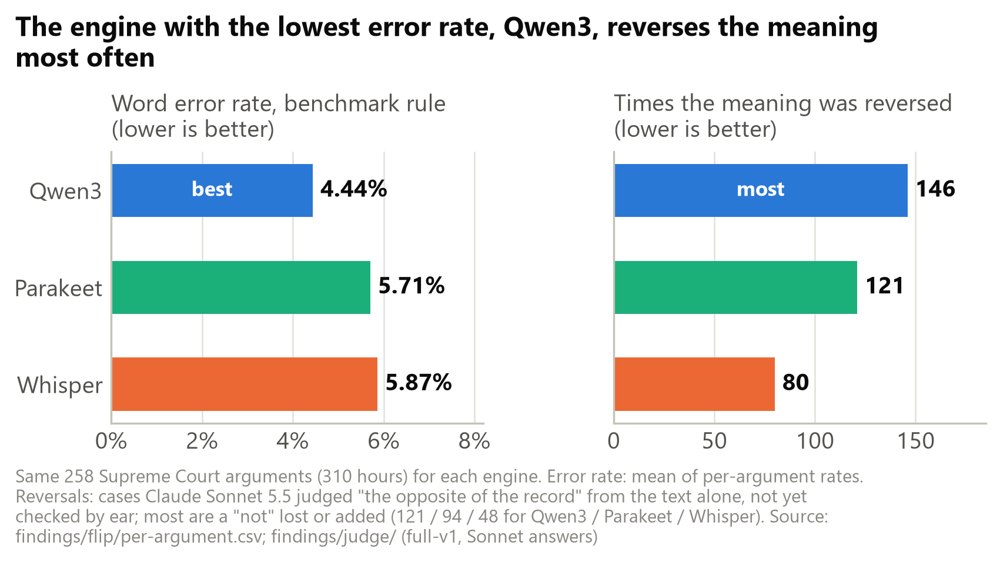

# Midterm draft (DATA 698), started 7 November 2026

Drafted in conversation with Claude Code: Noah talks, Claude writes it up in his voice and
checks every number against the project's data. `[CHECK: ...]` marks anything not yet
confirmed. ⟳ marks a number that may still change.

---

## 1. Introduction

This paper looks at how people and machines transcribe speech that is hard to hear or hard
to interpret. I am investigating three things. The first is how human transcribers and
speech recognition (ASR) engines each handle ambiguous speech, shown through the clips
themselves, with their transcripts side by side, so that a reader can hear the ambiguity
and judge it. The second is how the word error rate (WER), the standard measure of
transcription accuracy, can overlook the errors that matter most, which Atwany et al.
(2025) measure as a hallucination error rate (HER). The third is whether engines that lean
more on a large language model hallucinate more often, more seriously, or both.

In some settings none of this matters. A transcript of a low-stakes, casual conversation
that is kept only for reference may never matter to anyone at all. But when the stakes are
higher, in legal proceedings, medical transcription, or hiring and firing decisions,
getting important words wrong can fail to communicate or, worse, invert the meaning for the
people downstream who act on an imperfect transcript, or on a summary of one. A good WER
can also give rise to unwarranted confidence. That backfires when an engine confidently
writes something that is linguistically sensible but unfaithful to what was said, and
perhaps even false.

The closest earlier study is Atwany et al. (2025), who measured hallucinations in more than
20 speech recognition models (section 2.5). Two things set this project apart. The first is
the reference. Their paper calls the reference "the ground truth" throughout, and their
judge was told it is "the original, accurate text." I call this assumption reference
monism, the idea that a recording has exactly one correct transcript, and part of this
project is showing where it breaks down. The second is the audience. This project is
less academic-facing and more public-facing. Its main deliverable is a website that makes
the row-level data approachable: each flagged moment can be played and read against every
transcript of it. Those differences are hard to appreciate on paper if you are not in the
world of ASR or transcription. The engines are also newer: Qwen3-ASR, for example, where
Atwany et al. tested Qwen2-Audio-7B, an earlier and larger model from the same maker.

So far I have transcribed 730 recordings (625.5 hours) from four data sets with up to seven
open engines (section 3). Two preliminary findings stand out. They are two surprising sides of the same coin, though both are intuitive once you
understand how ASR works. The engine that wins the standard benchmark, Qwen3, reverses the
meaning of what was said more often than the other two engines the judge reviewed (146
times on the Supreme Court recordings, against 121 for Parakeet and 80 for Whisper). And
the engines fail in different ways. Parakeet, which has almost no language model, tends to
produce garbled text, while Qwen3, which is mostly language model, tends to produce fluent
text that is wrong. A larger language model does not simply mean more errors; it means
errors that are harder to spot.

I have worked as a court reporter for 15 years, which is how I came to the question. I have
honestly wondered at times whether I misheard or misunderstood some of what was said on the
record. I have come to appreciate that I am fallible, just like every other method of
transcription. I have learned to weigh my own abilities against the alternatives, and this
research has deepened my understanding of what ASR can and cannot do.

Section 2 reviews the literature, section 3 the data and methods, section 4 the preliminary
results, and section 5 the limits and the plans for the final paper.

## 2. Literature review

### 2.1 The reference is a judgment

Speech recognition is usually scored against a reference transcript as if the reference
were simply what was said. But a transcript is a listener's best account of what was
said, and audio does not always settle the question. Perception research shows that
listeners fill gaps with the word they expect. In Warren's phonemic-restoration
experiment, a cough replaced one sound in the word "legislatures"; listeners heard the
whole word and could not say where the cough fell (Warren 1970). So careful human
transcription is not perfectly repeatable. In a study of English
telephone speech, careful transcripts of the same audio differed by 4.1 to 4.5%, and 95%
of those differences were judgment calls over contractions, rapid speech or disfluencies
(Glenn et al. 2010).

The law is built around this. Federal law makes a court reporter's certified transcript
"prima facie a correct statement" of what was said (28 U.S.C. § 753(b)): a strong
presumption, not a guarantee. In federal appeals, a dispute over "whether the record truly
discloses what occurred" is settled by the trial court (Fed. R. App. P. 10(e)). The Supreme Court itself calls its
same-day transcripts "official but subject to final review" (Supreme Court of the United
States, n.d.).

None of this means court transcripts are unreliable. It means the law treats the record as
the best available account, not as the sound itself. When an engine disagrees with the
record, either one may be wrong, which is why I call the official transcript the
reference, not the truth.

### 2.2 Transcription styles differ, and benchmarks hide it

Every transcript follows a style, and styles differ on exactly the points speech
recognition gets wrong. The federal courts drop fillers but keep grammar as spoken (Guide
to Judiciary Policy, Vol. 6, § 520.40.10(b)). Earnings-22's builders chose verbatim
transcripts "to best model real human speech", using Rev's human service (Del Rio et al.
2022), and Rev's verbatim style keeps fillers, stutters and repetitions. CORAAL keeps
grammatical features of African American English such as "was" for "were" (Kendall and
Farrington 2023).

Benchmarks deal with this by normalising both texts before scoring, which removes most of
the style. OpenAI's normaliser, the basis of the one the Open ASR Leaderboard applies to
every model it ranks (Srivastav et al. 2025), was built to stop penalising Whisper for
"innocuous" differences, and its authors warned it may overfit to Whisper's own style
(Radford et al. 2023). The ESB benchmark took the other side and kept punctuation and
casing, arguing that normalising for one data set assumes knowledge of its text style
(Gandhi et al. 2022). Researchers at Rev scored engines against both Earnings-22
references and found the result depends heavily on which one is used (McNamara et al.
2024); OpenAI's engine scored 6.4% against the clean reference and 13.1% against the
verbatim one. Normalisation even shapes the research on fairness: Koenecke et al. (2020)
found commercial engines made almost twice as many errors for Black speakers as for white
speakers, but before scoring they changed "aks" to "ask" and removed fillers, so part of
what any such gap measures is style. A legal record cannot be normalised in this way,
because its punctuation, its speaker labels and its "--" are part of what it says.

### 2.3 Machines, like people, hear what they expect

Every listener combines what the sound allows with what is likely to have been said. In
the terms of information theory, transcription is decoding a noisy channel: the best guess
weighs how well each candidate fits the sound against how probable it was beforehand
(MacKay 2003, sections 2.3 and 9.4). A strong prior can overrule the sound; a weak one
lets the sound through, mistakes and all. People do this, as Warren's listeners did. In
one study, 27 court reporters working in the Philadelphia courts, all certified at 95%
accuracy or better, transcribed recorded sentences of African American English. On
average they got 59.5% of the sentences right, and 82.9% of the words (Jones et al. 2019).

Speech engines have priors too, and in modern engines the prior is built in. Whisper's
authors call its decoder "an audio-conditional language model" (Radford et al. 2023), and
newer engines put a full text language model behind the audio. The cost shows up in
predictable places. Habitual "be" in African American English is misrecognised more
often, plausibly because the language model turns "I be in my office by 7:30" into "I'll
be" (Martin and Tang 2020). Across more than 20 models, Atwany et al. (2025) found that
encoder-only models, which have no language model writing the text, produced the fewest
hallucinations relative to their errors. The question this raises for the court record is
whether engines differ in how much they write what a speaker probably meant instead of
what they said, which section 4.3 looks at.

### 2.4 Not every error matters equally

Word error rate counts every mistake as one, and the literature increasingly treats that
as its main weakness. Koenecke et al. (2024) found invented phrases in about 1% of
Whisper's transcriptions, 38% of them harmful, and named courtroom use as a risk.
Atwany et al. (2025) proposed a hallucination error rate to sit beside word error rate,
because "low WERs may conceal dangerous hallucinations". Semantic measures such as SemDist
score how far the meaning moved instead of counting words (Kim et al. 2021).

The courts already rank errors in practice, if not in a formula. Losing a "substantial and
significant portion of the record" can reverse a conviction (United States v. Selva, 559
F.2d 1303, 5th Cir. 1977), while a search of case law for this project found no reported
appeal that turned on a reporter correcting grammar. Drawing on these standards, I sort differences between an engine and the record into four kinds: tidying
(fillers dropped, contractions changed), standardising (grammar rewritten toward standard
English), mishearing, and invention. Only the last three break the rule that the record
keeps what was said, and invention and standardising carry the highest legal and social
stakes.

### 2.5 The closest earlier study

The work closest to mine is Atwany et al. (2025), who tested more than 20 speech
recognition models on about ten data sets, plus noisy copies, and found that "low WERs may
conceal dangerous hallucinations." Their study is larger and more technical than mine, and
I do not try to match it. It differs in four ways. They treat the reference as the truth;
I treat it as one listener's judgment. They score only after a Whisper-style normaliser; I
score both that way and as a record. They use clips of about 20 seconds; I transcribe whole
recordings of up to an hour. And their judge counts a change of "phrasing, grammar, or
structure" that keeps the meaning as "No Error", where I count a change to a speaker's
grammar as an error of its own. Their one legal data set is not the same court as mine:
its transcripts, short unpunctuated clips, are from the Supreme Court of India, addressing
the bench as "my lord".

## 3. Data and methods

### 3.1 Data

I tested the speech engines on four data sets of real speech, not read-aloud test
sentences. Each one is a different piece of the same question, because each puts a
different source of error in the foreground.

- **Supreme Court oral arguments**, four terms (2010, 2017, 2021, 2025). The Court posts
  its audio and an official transcript made by a contracted court reporting firm: a
  transcript made for the record, not for a benchmark.
- **Earnings-22** (company earnings calls), released by the transcription company Rev and
  part of Hugging Face's Open ASR Leaderboard. Ten calls have two professional transcripts
  of the same audio, one verbatim and one cleaned up.
- **EdAcc** (video calls between speakers with a wide range of accents). I expected it to
  trip the engines up: at its release the best engine scored 19.7% (Sanabria et al. 2023).
  It was less of a struggle than I expected; the best engine here scored 11.44%, though the
  two papers clean up the text differently.
- **CORAAL** (interviews in African American English). Its transcripts keep grammar the
  standard written language would "correct", so it shows which engines tidy it.

All seven engines ran on the Supreme Court data, five on EdAcc, and three (Qwen3, Whisper
and Parakeet) on CORAAL and Earnings-22, so the seven-engine comparison comes from the
Court, and the other data sets test whether the patterns hold. Four data sets is a limit
set by time, not a claim that these are the only right ones.

### 3.2 The engines

All seven engines are open models that I ran on my own laptop, which has an NVIDIA RTX 5090
with 24 GB of video memory. That limit decided which models could be in the study at all.
Within it, I chose them for a mix of reasons. Qwen3-ASR and Whisper were obvious choices:
they are two of the strongest open engines, and Whisper is the one most people have heard
of. Parakeet was there because it is built differently. It leans far less on a language
model and writes more directly from the sound, and I wanted engines from both ends of that
range. I added IBM's two Granite models because IBM says the Plus version can also mark who
is speaking and when each word was said (IBM 2026); in the end I used only its word
timings. Voxtral and Canary had no particular rationale beyond seeing how they did.

Table 1. The seven engines, ordered by how much of each engine listens to the audio.

| Engine | Maker | Design | Audio side | Text side | Total | Audio share |
|---|---|---|---|---|---|---|
| Voxtral Mini 3B | Mistral | speech LLM | 637M (Whisper's encoder) | 3.61B (Ministral 3B) + 403M output layer | 4.68B | 14% |
| Qwen3-ASR 1.7B | Alibaba | speech LLM | 314M | 1.72B (Qwen3-1.7B) | 2.04B | 15% |
| Granite Speech 4.1 2B | IBM | speech LLM | 440M | 1.63B (Granite 4.0 1B, LoRA-adapted) + 206M output layer | 2.31B | 19% |
| Granite Speech 4.1 2B Plus | IBM | speech LLM | ~440M | ~1.63B (the same LLM) | 2.11B | ~21% |
| Whisper large-v3 | OpenAI | encoder-decoder | ~637M | ~0.9B decoder | 1.55B | ~41% |
| Canary 1B v2 | NVIDIA | encoder-decoder | 811M | 151M decoder | 0.98B | 84% |
| Parakeet TDT 0.6B v3 | NVIDIA | transducer | 609M | 12M prediction network + 5M joint network | 0.63B | 97% |

Sizes marked ~ are estimates. The speech LLMs (Qwen3, Voxtral and the two Granites) put a
full text language model, the kind behind a chatbot and trained on ordinary text, behind
the audio encoder. The encoder-decoders (Whisper and Canary) have a text decoder of their
own, trained only on transcripts. Parakeet, a transducer, steps through the audio frame by
frame with only a tiny network remembering the last few words. My expectation was that the
more language model an engine has, the more it would write what a speaker probably meant
instead of what they said. Section 4 shows that this is only partly true. Granite Plus
writes no punctuation or capitals, by IBM's choice; its results are from the April 2026
release.

### 3.3 Scoring

Word error rate is the wrong, missing and added words divided by the words in the
reference (on the Supreme Court, the mean of each argument's rate; elsewhere, pooled over
recordings). Both texts are usually "normalised" first, rewritten into a common form so
that differences nobody would call mistakes are not counted. I score every transcript under
two rules:

- the **benchmark rule**: OpenAI's English normaliser (Radford et al. 2023), the one
  leaderboards use, plus a few fixes for differences nobody can hear, such as "U.S." split
  in two;
- the **verbatim rule**: punctuation, capitals, fillers and the reporter's "--" all count,
  which is closer to the question "could this be the record?"

Court reporters have a written standard of their own. NCRA's Registered Professional
Reporter (RPR) skills test is graded against a master transcript, and passing is 95%
accuracy (NCRA 2026a; 2026b). Table 2 sets its grading guide beside the normaliser.

Table 2. What counts as an error: NCRA's RPR grading guide and OpenAI's English normaliser.

| Difference | NCRA RPR skills test (NCRA 2026b) | OpenAI normaliser (benchmark rule) |
|---|---|---|
| Wrong, missing or added word | one error each | one error each |
| The wrong acronym ("CIA" for "FBI") | three errors | one error |
| Capitals and punctuation | each missing capital or required period, comma or question mark is an error; all lowercase fails outright | all removed; never counted |
| Contractions ("don't" for "do not") | one error | both rewritten as "do not"; never counted |
| Fillers ("uh", "um") | not addressed; the test is dictated material | six filler words deleted from both texts |

The two agree on the basic count but part on everything about how a transcript is
written, and NCRA weights some errors above others. On fillers neither settles the
question: the federal rule leaves them out unless leaving them out "could change a
statement's meaning" (Guide to Judiciary Policy, Vol. 6, § 520.40.10(b)), a judgment call
where the normaliser makes a fixed rule. And neither count says how much an error matters:
a dropped "uh", a lost "not" and an invented phrase each count as a few words at most.

### 3.4 Finding the errors that matter

I searched each engine's transcripts for four kinds of difference from the reference:
changes of meaning (a lost or added "not", a different number or word), words nobody
said, edits to the speaker's grammar, and skipped speech. The searches are plain rules in
Python; they can find a "not" on one side only, but not say whether the meaning really
changed. So each case they found, 37,354 in all, was read by a language model acting as a
judge, Claude Sonnet 5.5. It saw the reference and the engine's text with a minute either
side, and answered whether the meaning stayed the same, was reworded, changed, reversed or
garbled, how serious that was (0 to 4), and whether the reference itself looked wrong. A
local model, Qwen 3.8 27B, is still working through the cases as a second check.

I tested the prompt first on a smaller model. The first version failed a simple control:
shown two identical texts with the search rule's claim that they differed, the judge agreed
with the rule. Later prompts passed. On 350 random cases, Sonnet matched an answer key's
meaning label 70% of the time, and its call on whether the difference matters 86%. But the
answer key was itself written by language models, not by a person, and the judge reads text,
not audio: it cannot tell a speaker's slip of the tongue from an engine's mishearing. Its
labels are a way of sorting thousands of cases so a person can listen to the ones that
matter first, not a verdict on any of them.

### 3.5 Problems along the way

Running seven engines over hundreds of hours on one laptop was much more involved than
pointing a model at a file. Most engines take only a short stretch of audio at once, so
each recording is cut into overlapping pieces and stitched back together, and most problems
came from those joins: one engine sometimes stopped writing partway through a piece, some
pieces lost their punctuation, and a few came back empty. Each was fixed, and the affected
pieces transcribed again, before any result here was computed. The code was written largely
with Claude Code under my direction (see the AI-use statement), and is in the project's
repository: https://github.com/nono638/scotus-asr-capstone-public.

## 4. Preliminary results

### 4.1 How good the engines are

The first thing I found was that open engines running on a laptop are much better than I
had assumed. I expected that only the cloud services were this accurate. Under the
benchmark rule, the best of the seven, Qwen3-ASR, scored 4.24% word error on the Court's
2017 term, and even the weakest, Granite, scored 7.76% (Table 3). On EdAcc, Qwen3 beat the
commercial transcript that comes with the data set on all 40 test conversations (11.44%
against 17.46%), though that transcript dates from 2023.

Table 3. Word error rate on the Supreme Court's 2017 term (61 arguments), under both rules.

| Engine | Benchmark rule | Verbatim rule |
|---|---|---|
| Qwen3-ASR | 4.24% | 14.98% |
| Whisper | 5.71% | 14.01% |
| Parakeet | 5.77% | 17.18% |
| Voxtral | 5.91% | 14.18% |
| Granite Plus | 6.27% | 28.92% |
| Canary | 6.68% | 16.12% |
| Granite | 7.76% | 17.14% |

### 4.2 The two rules pick different winners

Every engine does much worse when it is scored as a record. On the 2017 term, the verbatim
rule gives each engine 2.2 to 4.6 times the error rate the benchmark rule gives it (2.2 to
3.5 times leaving out Granite Plus, which writes no punctuation by design). The two rules
also disagree about which engine is best. Qwen3 is best under the benchmark rule, but under
the verbatim rule Whisper is best (14.01%), with Voxtral close behind (14.18%) and Qwen3
third (14.98%).

The disagreement holds argument by argument. Over all four terms, the two rules crowned
different engines in 190 of 258 arguments (74%), and it happened in most arguments of
every term (Figure 1). So in most arguments, a leaderboard would recommend a different
engine from the one that comes closest to the record.

Figure 1. Qwen3 against Whisper, argument by argument, under both rules.

To me this says less about which engine is better than about the question being asked.
Each rule measures something real, but neither is what a court cares about. Court
transcription, like court interpreting, is meant to be conservative: a rendering "without
altering, omitting, or adding anything to what is stated" (NCSC Model Code, Canon 1). The
federal rule lets fillers go but requires grammar to be "transcribed as spoken" (Guide to
Judiciary Policy, Vol. 6, § 520.40.10(b)). So dropping a filler is allowed; tidying "he
don't" to "he doesn't" is not, even though the meaning survives; and inventing words is the
worst of all. A single error rate, under either rule, counts all three alike. Sorting
errors by what they do is the subject of the next section.

### 4.3 The errors that matter

The judge's labels add what neither error rate can: what each difference does to the
meaning. All of these come with the limits in section 3.4: judged from text only, and not
yet checked by ear.

**The benchmark winner reverses the meaning most often.** On the same 258 arguments, the
judge found Qwen3's text saying the opposite of the record 146 times, Parakeet's 121 and
Whisper's 80 (Figure 2), mostly a "not" lost or added. A sample of Qwen3's cases shows real
reversals: "where it can't act directly" written as "where it can act directly", "the legal
agreement" as "the illegal agreement", "knowing and voluntary" as "knowing involuntary".
These pairs sound nearly alike, and the judge thought the record itself might be wrong in
only a few of them. So the engine a leaderboard would pick is also the one most likely to
flip what a lawyer or justice said.

Figure 2. Error rate and reversals of meaning, same 258 arguments. The error rates here
cover all four terms, so they differ slightly from Table 3, which is the 2017 term only.

**On Earnings-22, the reference is often the problem.** The judge thought the reference
itself looked wrong in 27% of the Earnings-22 cases, and possibly wrong in another 20%,
against 1 to 3% on the other data sets. Where all three engines agreed against it, for
example "kindly" where the reference has "currently", or "billion" for "million", each
counts against the engines as an error. This is the clearest evidence in the project that
a reference is one listener's judgment, not the truth.

**How an engine is wrong follows partly from how it is built** (section 3.2). Of the meaning-change
cases the judge read, it called Parakeet's text garbled, meaning it no longer made sense,
in 43% on the Supreme Court, 37% on CORAAL, 38% on Earnings-22 and 27% on EdAcc. For Qwen3
the same figures were 19%, 16%, 11% and 12%. Qwen3's errors were more often fluent instead:
a rewording or a reversal that still reads naturally (24% of its cases on the Court, 28% on
CORAAL). A garbled error is one a reader can see is wrong; a fluent one is not. This fits
Atwany et al. (2025). But design is only part of it. Whisper, in the middle, writes the
court reporter's "we -- we" as one "we" 82% of the time against Qwen3's 21%, and rewrites
more African American English grammar into standard English (24% of the places counted on
CORAAL, against 18%). How much an engine smooths depends on its design and on the style of
the transcripts it was trained on. Most flagged differences did not matter much: only 6 to
10% of the cases on each data set were judged serious (3 or 4 on the 0 to 4 scale).

**Where errors happen matters far more than which engine makes them.** A logistic
regression over every word of the 2017 term, for all seven engines, with each argument
allowed its own difficulty, asked what makes a word likely to be missed. The odds of a miss
were 5.7 times higher for the first word after a speaker change, 6.7 times higher next to
the reporter's "--", which marks an interruption, and 15.8 times higher for a legal term (a
rough estimate: 95% interval 10.9 to 22.9). The conditions explained about 41 times as much
of the errors as the choice of engine did, and the pattern held after the repairs and with
Parakeet left out. It is an association, not a cause: part of it is crosstalk, where the
reporter wrote down two people talking at once and the engines kept only one.

## 5. Limits and next steps

### 5.1 Limits

The biggest limit is that nobody has yet listened to the flagged cases; the judge read
text, and was checked against other language models. Some errors counted against the
engines are the reference's. The searches find only what their rules look for, so their
counts are a floor, and the error model shows association, not cause. Only the Supreme
Court data has all seven engines. And I have a stake in the answer, as a working court
reporter, which is one more reason for human listening.

### 5.2 Next steps for the final paper

- **Listen** to a sample of the serious cases, and let invited raters on the website
  record their own verdicts (wider rating waits on CUNY's human research protection office).
- **Better judges**: the local Qwen judge as a second opinion, and a judge that hears the
  audio, not only the text.
- **One more engine**: NVIDIA's new Nemotron 3.5 Transcribe, on rented hardware (about $12
  for all four data sets), and more of the data sets Atwany et al. (2025) used.
- **A tool others can use.** Every piece of this pipeline exists somewhere, but I found
  nothing that puts them together for long real-world recordings, with named errors and the
  audio to hear them, or anything aimed at court transcripts. By December I hope to have a
  version others can point at their own recordings, and a website written for the general
  public.

### 5.3 Where this leaves machine transcription (my opinion)

This section is my opinion, not a finding. I have come away impressed. For low-stakes uses
these engines are already good enough, and better than I expected. What makes high-stakes
use risky is not the error rate but the inventions and reversals, because they read as
naturally as the truth. Each disputed spot still needs a person to decide whether there is
a clear answer to what was said, and errors should be judged by what they do, not only
counted. As more of what we say is transcribed by machines, people may also need to speak
for a machine audience as well as a human one: explicit is better than implicit. But that
burden would fall hardest on the speakers the engines already handle worst, accented
speakers and speakers of African American English (Koenecke et al. 2020). The other half of
the answer is to check what the machines write before relying on it.

## AI-use statement

I used AI tools throughout this project. Claude Code (Anthropic) wrote nearly all of the
project's code under my direction, and I have not reviewed that code line by line. Claude
also drafted this paper from my spoken answers to its questions, checked each number
against the project's data, and found and checked sources. I chose the questions, the data
sets, the engines and the framing, and I read and revised the text. Language models also do
part of the analysis, as section 3.4 describes: Claude Sonnet 5.5 judged the flagged cases,
and Claude Opus 5.5 agents wrote the answer key it was checked against. I used Google's
NotebookLM (Gemini) to survey the literature, and am reading the cited passages directly.

## References

Atwany, H., Waheed, A., Singh, R., Choudhury, M., & Raj, B. (2025). Lost in transcription,
found in distribution shift: Demystifying hallucination in speech foundation models.
*Findings of the Association for Computational Linguistics: ACL 2025*.
https://arxiv.org/abs/2502.12414

Del Rio, M., Ha, P., McNamara, Q., Miller, C., & Chandra, S. (2022). Earnings-22: A
practical benchmark for accents in the wild. arXiv:2203.15591.
https://arxiv.org/abs/2203.15591

Federal Rules of Appellate Procedure, Rule 10(e).

Gandhi, S., von Platen, P., & Rush, A. M. (2022). ESB: A benchmark for multi-domain
end-to-end speech recognition. arXiv:2210.13352. https://arxiv.org/abs/2210.13352

Glenn, M. L., Strassel, S. M., Lee, H., Maeda, K., Zakhary, R., & Li, X. (2010).
Transcription methods for consistency, volume and efficiency. *Proceedings of the Seventh
International Conference on Language Resources and Evaluation (LREC 2010)*.
http://www.lrec-conf.org/proceedings/lrec2010/pdf/849_Paper.pdf

IBM. (2026). *granite-speech-4.1-2b-plus* [Model card]. Hugging Face.
https://huggingface.co/ibm-granite/granite-speech-4.1-2b-plus

Jones, T., Kalbfeld, J. R., Hancock, R., & Clark, R. (2019). Testifying while black: An
experimental study of court reporter accuracy in transcription of African American English.
*Language, 95*(2), e216–e252. https://doi.org/10.1353/lan.2019.0042

Judicial Conference of the United States. (n.d.). *Guide to Judiciary Policy*, Vol. 6,
§ 520.40.10(b), Editing of speech [Transcript format rule, District of Montana copy].
https://www.mtd.uscourts.gov/sites/mtd/files/Transcript%20Format%202020.pdf

Kendall, T., & Farrington, C. (2023). *The Corpus of Regional African American Language*
(Version 2023.06). The Online Resources for African American Language Project.
https://doi.org/10.7264/1ad5-6t35

Kim, S., Arora, A., Le, D., Yeh, C.-F., Fuegen, C., Kalinli, O., & Seltzer, M. L. (2021).
Semantic distance: A new metric for ASR performance analysis towards spoken language
understanding. *Proceedings of Interspeech 2021*.
https://www.isca-archive.org/interspeech_2021/kim21e_interspeech.html

Koenecke, A., Choi, A. S. G., Mei, K. X., Schellmann, H., & Sloane, M. (2024). Careless
Whisper: Speech-to-text hallucination harms. *Proceedings of the 2024 ACM Conference on
Fairness, Accountability, and Transparency (FAccT '24)*, 1672–1681.
https://arxiv.org/abs/2402.08021

Koenecke, A., Nam, A., Lake, E., Nudell, J., Quartey, M., Mengesha, Z., Toups, C.,
Rickford, J. R., Jurafsky, D., & Goel, S. (2020). Racial disparities in automated speech
recognition. *Proceedings of the National Academy of Sciences, 117*(14), 7684–7689.
https://doi.org/10.1073/pnas.1915768117

MacKay, D. J. C. (2003). *Information theory, inference, and learning algorithms*.
Cambridge University Press.

Martin, J. L., & Tang, K. (2020). Understanding racial disparities in automatic speech
recognition: The case of habitual "be". *Proceedings of Interspeech 2020*.
https://www.isca-archive.org/interspeech_2020/martin20_interspeech.html

McNamara, Q., del Río Fernández, M. Á., Bhandari, N., Ratajczak, M., Chen, D., Miller, C.,
& Jetté, M. (2024). Style-agnostic evaluation of ASR using multiple reference transcripts.
arXiv:2412.07937. https://arxiv.org/abs/2412.07937

National Center for State Courts. (n.d.). *Model code of professional responsibility for
interpreters in the judiciary* [Delaware Courts copy].
https://www.courts.delaware.gov/forms/download.aspx?id=134438

NCRA. (2026a). *SKT: How are the tests graded?* National Court Reporters Association.
https://ncra.org/detail-pages/faq-detail/certification---how-are-the-tests-graded

NCRA. (2026b). *What is an error? Grading guidelines for the RSR, RPR and RMR skills tests*
(last updated March 2026). National Court Reporters Association.
https://www.ncra.org/docs/default-source/uploadedfiles/certification/rsr-rpr-rmr-what-is-an-error.pdf

Radford, A., Kim, J. W., Xu, T., Brockman, G., McLeavey, C., & Sutskever, I. (2023). Robust
speech recognition via large-scale weak supervision. *Proceedings of the 40th International
Conference on Machine Learning*, PMLR 202, 28492–28518.
https://proceedings.mlr.press/v202/radford23a.html

Sanabria, R., Bogoychev, N., Markl, N., Carmantini, A., Klejch, O., & Bell, P. (2023). The
Edinburgh International Accents of English Corpus: Towards the democratization of English
ASR. *ICASSP 2023*. https://arxiv.org/abs/2303.18110

Srivastav, V., Zheng, S., Bezzam, E., Le Bihan, E., Koluguri, N. R., Żelasko, P.,
Majumdar, S., Moumen, A., Gandhi, S., et al. (2025). Open ASR Leaderboard: Towards
reproducible and transparent multilingual and long-form speech recognition evaluation.
arXiv:2510.06961. https://arxiv.org/abs/2510.06961

Supreme Court of the United States. (n.d.). *Argument transcripts*.
https://www.supremecourt.gov/oral_arguments/argument_transcript/2022

United States v. Selva, 559 F.2d 1303 (5th Cir. 1977).

28 U.S.C. § 753(b).

Warren, R. M. (1970). Perceptual restoration of missing speech sounds. *Science, 167*(3917),
392–393. https://doi.org/10.1126/science.167.3917.392

---

## Notes for later sections (not draft text)

- Final paper / after the midterm: make the website more general-public facing (Noah,
  8 Nov). The project is less academic-facing than Atwany et al.; the site is how a reader
  outside ASR and transcription gets to see the problem.
- Introduction, "what I learned": I had pictured speech recognition as a sound step followed
  by a separate language step. Modern engines are trained as one network from sound to text,
  and four of the seven (Qwen3, Voxtral, the two Granites) carry a full language model of a
  billion or more parameters inside it.
- Discussion / section 5, opinion, to be framed as such: as more of what we say is
  transcribed by machines, people may need to speak for a machine audience as well as a
  human one ("explicit is better than implicit"). Pair it with the fairness point: the
  engines handle accented speakers and African American English worst (EdAcc, CORAAL;
  Koenecke et al. 2020), so "speak more clearly for the machine" falls hardest on them.
  The other half of Noah's point: check what the machines write before relying on it.
- Discussion: each disputed spot needs a human to say whether there is a clear answer to
  what was actually said; errors should be classified in a stakes-aware way; where the line
  falls between acceptable cleaning and unacceptable change is debated (the four kinds:
  tidying, standardising, mishearing, invention). Strengths and weaknesses of each engine
  come from both its design and the data it is listening to.
- Section 5, my view on stakes: impressed for low-stakes use; inventions are what make
  high-stakes use risky.
- Section 5, next steps: a judge that hears the audio; an open search where a judge lists
  every difference in a minute of text ("misses"); Granite Plus speaker labels as a small
  pilot (a separate mode, needs its own run); more of Atwany et al.'s data sets.
- Section 5, the December tool: every piece exists somewhere (jiwer, whisper-normalizer,
  fstalign, the Open ASR Leaderboard's chunking code, NeMo Speech Data Explorer for playback),
  but nothing found puts them together for long real-world recordings with named
  meaning-level errors and playback, and nothing is aimed at court transcripts. Claim the
  integration and the court angle, not the scoring. Details: `existing-tools.md`.
